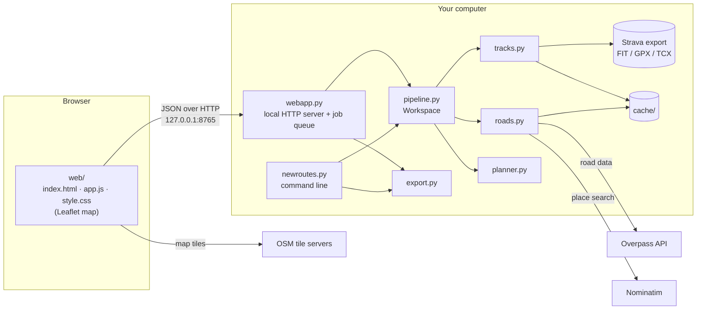

# Architecture

How the planner is put together, for anyone changing it. For using it, see the
[README](../README.md) and the [web app guide](web-app.md).

## Overview



Both front ends (the web app and the command line) build a `RouteRequest` and hand it to the
same `pipeline.Workspace`, so they always plan identically and share every cache.

## Modules

| Module | Responsibility |
|---|---|
| `tracks.py` | Reads the Strava export's `activities.csv` and every FIT/GPX/TCX file, in parallel, into GPS tracks. Caches them in `cache/tracks.pkl`, so only new activities are parsed. |
| `roads.py` | Downloads OpenStreetMap ways from Overpass in tiles, builds the road graph with OSMnx, and stores it as plain numpy arrays (`RoadGraph`). Matches GPS points to roads to get each road's traveled fraction. Also handles place search (Nominatim) and the list of cached areas. |
| `planner.py` | The route search: an orienteering problem solved with randomised greedy insertion plus ruin-and-recreate. It maximises untraveled metres within the distance budget. Handles loops and one-way (A → B) routes. |
| `pipeline.py` | One route request end to end: find the export, load activities, pick or download the road graph, compute coverage, snap start and finish to the network, and search. `Workspace` keeps activities and up to three graphs in memory between requests. `PlannerError` carries messages meant for the user. |
| `export.py` | Output: GPX, the command line's Folium HTML map and JSON summary, and the route segments and nearby roads that the web app draws. |
| `newroutes.py` | The command line. |
| `webapp.py` | The web app's server: static files, a JSON API, and a single background worker that runs searches. |
| `web/` | The page: plain HTML, CSS and JavaScript with no build step. Leaflet 1.9.4 is loaded from unpkg with subresource integrity. |
| `tests/` | `unittest` suites for the planner and the HTTP API, run on a synthetic street grid (`tests/synthetic.py`). |

## What happens for one route request

1. **Activities.** `Workspace.all_tracks()` loads the export once per process. Tracks are
   filtered to the activity type (rides for `ride`; runs, walks and hikes for `run`) unless
   `count_all_activities` is set.
2. **Start.** If none is given, the start is the most common start cell (about 200 m) among
   those activities.
3. **Road graph.** A route of length D, with tolerance t, can only reach points whose distances
   to the start and to the finish add up to at most D·(1+t). That is an ellipse, and for a loop
   a circle of radius D·(1+t)/2. The workspace needs a cached graph whose circle contains that
   circle plus 1.5 km. `roads.find_cached_graph` picks the smallest that does. Otherwise a new
   graph is downloaded, centred on the rounded start (or midpoint) with the radius rounded up to
   5 km, so nearby requests reuse it.
4. **Coverage.** Every road is sampled every 10 m. A sample counts as traveled if a densified GPS
   point lies within 20 m. The result is cached per graph and per set of activities.
5. **Search.** `Planner` discounts untraveled roads in the routing cost, chooses candidate
   waypoints from the cells with the most new road, and runs shortest paths from all of them at
   once. It then builds and improves tours. For A → B, the direct start → finish leg is
   budgeted from the start. If even that leg doesn't fit, `plan()` returns nothing and records
   `direct_m`, so the pipeline can say what distance would work.
6. **Result.** A `RouteResult` holds the plans (node and edge sequences), the graph and the
   untraveled length per road. Each front end turns those into files or JSON.

## Caches

Everything lives in `cache/`, which is git-ignored because it describes where you go.

| File | Contents | Invalidated by |
|---|---|---|
| `tracks.pkl` | Parsed GPS tracks, by activity ID | Never; new activities are added |
| `osm_<mode>_<lat>_<lon>_<radius>.osm` | Raw Overpass download for an area. While downloading, each finished tile is kept, so downloads resume. | Delete to re-download |
| `graph_<mode>_<lat>_<lon>_<radius>.pkl` | The built `RoadGraph` | Delete to rebuild from the `.osm` |
| `coverage_<hash>.npy` | Traveled fraction per road | Automatic: the hash covers the graph and the activity IDs |
| `settings.json` | The export path used last | Overwritten by the next `--export` |

Graph and coverage files are written to a temporary name and then renamed, so an interrupted
write can't leave a corrupt cache file.

## The web app

### Why a local server

The planner is Python with numpy, SciPy and OSMnx, and it relies on caches that can be hundreds
of MB. Rewriting all that to run in a browser would be a large project. It would also have to
re-read the Strava export in the browser, and it would duplicate the command line. A local
server keeps one planner for both front ends, keeps your data on your machine, and needs no new
dependencies: `webapp.py` uses only Python's `http.server`, `threading` and `queue`. The page
is plain static files.

The trade-off is that you have to start `webapp.py` first. The [roadmap](roadmap.md) discusses a
hosted version.

### Searches are jobs

A search can take seconds, or many minutes when it has to download an area first. So
`POST /api/plan` returns a job ID straight away, and the page polls `GET /api/jobs/{id}` every
second.

- One daemon worker thread runs jobs in order. Searches are CPU-heavy and can share downloads,
  so running two at once wouldn't help. Because the thread is a daemon, Ctrl+C stops the app
  immediately.
- **Progress.** The planner reports progress with `print()`. `ThreadTee` replaces `sys.stdout`
  and copies the worker thread's output into the job's log, while still echoing it to the
  terminal. The page rewords the latest line ("tile 3/25" becomes "Downloading road data: part 3
  of 25…").
- **Memory.** A finished job keeps its `RouteResult` for GPX and context downloads. The big
  search structures are not kept, because the `Planner`'s shortest-path tables can be tens of
  MB. Only the last 12 jobs are kept.
- **Reloads.** `GET /api/config` reports `active_job`, and the page remembers its latest job ID.
  After a reload it follows a running search or redraws finished routes.

### HTTP API

All responses are JSON unless noted. Errors are `{"error": "message for the user"}` with a 4xx
or 5xx status.

**`GET /api/config`**: what the page needs at start-up.

```json
{
  "version": "0.2.0",
  "export": "/path/to/export_12345678",
  "export_problem": null,
  "activities": {"ride": 1200, "run": 450},
  "usual_start": {"ride": {"lat": 51.5007, "lon": -0.1246}, "run": {"lat": 51.5007, "lon": -0.1246}},
  "areas": [{"mode": "ride", "lat": 51.5, "lon": -0.12, "radius_m": 20000.0}],
  "active_job": null
}
```

**`POST /api/plan`**: start a search. The request must use `Content-Type: application/json`.

```json
{
  "mode": "ride",
  "distance_km": 40,
  "start": {"lat": 51.5007, "lon": -0.1246},
  "end": null,
  "alternatives": 3,
  "avoid_main_roads": 1,
  "eagerness": 0.6,
  "effort": "normal",
  "count_all_activities": false
}
```

`end` set to a point makes an A → B route. `effort` is `quick`, `normal` or `thorough`, which
means 4×20, 8×40 or 16×80 restarts × iterations. The response is `202 {"job": "3a356452eabb"}`,
or `400` for invalid input.

**`GET /api/jobs/{id}`**: a job's status: `queued`, `running`, `done` or `error`.

```json
{
  "id": "3a356452eabb",
  "status": "done",
  "log": ["...", "Searching for the route with the most new road..."],
  "elapsed_s": 9.8,
  "result": {
    "mode": "ride",
    "route_type": "loop",
    "distance_km": 40,
    "start": [51.5007, -0.1246],
    "end": null,
    "activities_used": 1200,
    "area": {"total_km": 5980.0, "traveled_km": 2140.0, "traveled_pct": 35.8},
    "routes": [
      {
        "index": 0,
        "distance_km": 41.2,
        "new_km": 25.1,
        "new_pct": 61,
        "targets": 9,
        "bounds": [[51.45, -0.21], [51.55, -0.05]],
        "segments": [{"new": true, "coords": [[51.5007, -0.1246], [51.5012, -0.1251]]}],
        "gpx_url": "/api/jobs/3a356452eabb/routes/0.gpx"
      }
    ],
    "context_url": "/api/jobs/3a356452eabb/context"
  }
}
```

`segments` are consecutive runs of new or already-traveled road, each starting where the
previous one ended. Coordinates are `[lat, lon]`, rounded to 5 decimals (about 1 m). A failed
job has `"error"` in place of `"result"`.

**`GET /api/jobs/{id}/routes/{n}.gpx`**: route `n` as a GPX 1.1 download
(`Content-Disposition: attachment`).

**`GET /api/jobs/{id}/context`**: roads around the routes for the background layers:
`{"untraveled": [[[lat, lon], ...], ...], "traveled": [...]}`. It leaves out separately mapped
sidewalks and crossings. It can be a few MB, so the page fetches it after drawing the routes.

**`GET /api/geocode?q=...&viewbox=west,north,east,south`**: place search through Nominatim,
which allows at most one request per second. The `viewbox` prefers matches in view without
excluding others. Returns `{"results": [{"name": "...", "lat": 0, "lon": 0}]}`.

### Security

The server can read your activity history and start downloads, so it only answers its own page:

- It listens on `127.0.0.1` by default. `--host 0.0.0.0` exposes it to the local network, with
  a warning in `--help` and the docs.
- **Host check:** requests must be addressed to `localhost`, `127.0.0.1` or `[::1]` (or the
  `--host` given). This blocks DNS-rebinding attacks from web pages.
- **Origin check:** if a browser sends an `Origin` header, it must match the `Host`, so other
  websites can't drive the API.
- `POST` bodies must be JSON (`application/json`), which also forces a CORS preflight that the
  server never approves. Bodies are capped at 64 KB.
- Static files are served only from `web/`, and only with known extensions. Paths are resolved
  and checked against the directory, so `..` tricks fail.
- The page is served with a Content-Security-Policy. Scripts come only from the server and
  unpkg (with SRI), connections only to the server, and the page can't be framed.
- The page puts place names and other external text into the page as text, never as HTML.

## Testing

```bash
.venv/bin/python -m unittest discover tests
```

- `tests/test_planner.py` checks that loops return to the start and one-way routes end at the
  finish, that every route stays within its distance budget, that impossible one-way requests
  return nothing instead of over-long routes, and that alternatives are distinct.
- `tests/test_webapp.py` starts the real HTTP server on a spare port, with a workspace whose road
  network is a synthetic grid and that has no Strava data. It runs searches through the API and
  checks the results, GPX and context downloads, input validation, the Host and Origin checks,
  and static file serving.

Neither needs network access or personal data, so they're safe to run anywhere.
