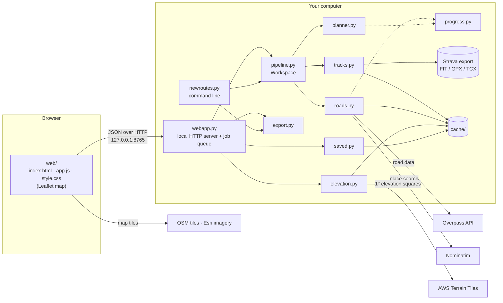

# Architecture

How the planner is put together, for anyone changing it. For using it, see the
[README](../README.md) and the [web app guide](web-app.md).

## Overview



Both front ends (the web app and the command line) build a `RouteRequest` and hand it to the
same `pipeline.Workspace`, so they always plan identically and share every cache. Elevation
and saved routes are web-app features, so far.

## Modules

| Module | Responsibility |
|---|---|
| `tracks.py` | Reads the Strava export's `activities.csv` and every FIT/GPX/TCX file, in parallel, into GPS tracks. Caches them in `cache/tracks.pkl`, so only new activities are parsed. |
| `roads.py` | Downloads OpenStreetMap ways from Overpass in tiles, builds the road graph with OSMnx, and stores it as plain numpy arrays (`RoadGraph`). Matches GPS points to roads to get each road's traveled fraction. Also handles place search (Nominatim), the list of cached areas, per-area download locks, and download timings for estimates. |
| `planner.py` | The route search: an orienteering problem solved with randomised greedy insertion plus ruin-and-recreate. It maximises untraveled metres within the distance budget and handles loops and one-way (A → B) routes. Also `reverse_loop()`, which turns a loop around and detours round one-way stretches. |
| `pipeline.py` | One route request end to end: find the export, load activities, pick or download the road graph, compute coverage, snap start and finish to the network, and search. `Workspace` keeps activities and up to three graphs in memory between requests, and estimates downloads (`estimate()`). `PlannerError` carries messages meant for the user. |
| `progress.py` | Progress reports and cancellation for the slow steps. Outside the web app it does nothing. |
| `elevation.py` | Ground heights from SRTM: downloads and caches 1° squares, interpolates heights, and builds route profiles with total ascent and descent. |
| `saved.py` | Saved routes on disk, in `cache/saved_routes/`. |
| `export.py` | Output: GPX (with elevation when it's available), the command line's Folium HTML map and JSON summary, and the route segments and nearby roads that the web app draws. |
| `newroutes.py` | The command line. |
| `webapp.py` | The web app's server: static files, a JSON API, and a single background worker that runs searches. |
| `web/` | The page: plain HTML, CSS and JavaScript with no build step. Leaflet 1.9.4 is loaded from unpkg with subresource integrity. |
| `tests/` | `unittest` suites for the planner, the download lock, elevation and the HTTP API, run on a synthetic street grid (`tests/synthetic.py`) with a synthetic hill for elevation. They need no network. |

## What happens for one route request

1. **Activities.** `Workspace.all_tracks()` loads the export once per process. Tracks are
   filtered to the activity type (rides for `ride`; runs, walks and hikes for `run`) unless
   `count_all_activities` is set.
2. **Start.** If none is given, the start is the most common start cell (about 200 m) among
   those activities.
3. **Road graph.** A route of length D, with tolerance t, can only reach points whose distances
   to the start and to the finish add up to at most D·(1+t). That is an ellipse, and for a loop
   a circle of radius D·(1+t)/2. The workspace needs a cached graph whose circle contains that
   circle plus 1.5 km. `roads.find_cached_graph` picks the smallest that does. Otherwise a new
   graph is downloaded, centred on the rounded start (or midpoint) with the radius rounded up to
   5 km, so nearby requests reuse it. The download is in tiles of 12 km or less, so the number of
   tiles is known in advance, which is what `Workspace.estimate()` reports.
4. **Coverage.** Every road is sampled every 10 m. A sample counts as traveled if a densified GPS
   point lies within 20 m. The result is cached per graph and per set of activities.
5. **Search.** `Planner` discounts untraveled roads in the routing cost, chooses candidate
   waypoints from the cells with the most new road, and runs shortest paths from all of them at
   once. It then builds and improves tours. For A → B, the direct start → finish leg is
   budgeted from the start. If even that leg doesn't fit, `plan()` returns nothing and records
   `direct_m`, so the pipeline can say what distance would work.
6. **Result.** A `RouteResult` holds the plans (node and edge sequences), the graph and the
   untraveled length per road. The web app then adds an elevation profile to each route, and
   each front end turns the result into files or JSON.

## Shared caches and concurrency

Everything lives in `cache/`, which is git-ignored because it describes where you go.

| File | Contents | Invalidated by |
|---|---|---|
| `tracks.pkl` | Parsed GPS tracks, by activity ID | Never; new activities are added |
| `osm_<mode>_<lat>_<lon>_<radius>.osm` | Raw Overpass download for an area. While downloading, each finished tile is kept, so downloads resume. | Delete to re-download |
| `graph_<mode>_<lat>_<lon>_<radius>.pkl` | The built `RoadGraph` | Delete to rebuild from the `.osm` |
| `coverage_<hash>.npy` | Traveled fraction per road | Automatic: the hash covers the graph and the activity IDs |
| `elevation/<square>.npy` | SRTM heights for a 1° square (3601 × 3601), memory-mapped when read | Never |
| `saved_routes/<id>.json`, `.gpx` | Saved routes | Deleted from the web app |
| `locks/<area>.lock` | Per-area download locks (empty files) | Never; they're tiny |
| `download_stats.json` | How long recent tiles took to download, for estimates | Keeps the latest 50 |
| `settings.json` | The export path used last | Overwritten by the next `--export` |

The command line and the web app can run at the same time and share these files:

- **Downloads are locked per area.** `roads.load_graph` takes an exclusive operating-system
  lock (`flock`, or `msvcrt` on Windows) before downloading and building an area. A second
  process waits, saying so, then finds the finished graph and reuses it. The OS releases the
  lock if its holder crashes, so an area can't stay locked.
- **Cache files are written to a temporary name and then renamed**: tracks, graphs, coverage,
  elevation, saved routes and download stats. An interrupted or concurrent write can't leave a
  half-written file in place.

## The web app

### Why a local server

The planner is Python with numpy, SciPy and OSMnx, and it relies on caches that can be hundreds
of MB. Rewriting all that to run in a browser would be a large project. It would also have to
re-read the Strava export in the browser, and it would duplicate the command line. A local
server keeps one planner for both front ends, keeps your data on your machine, and needs no new
dependencies: `webapp.py` uses only Python's `http.server`, `threading` and `queue`. The page
is plain static files.

The trade-off is that you have to start `webapp.py` first. The [roadmap](roadmap.md) discusses a
hosted version.

### Searches are jobs

A search can take seconds, or many minutes when it has to download an area first. So
`POST /api/plan` returns a job ID straight away, and the page polls `GET /api/jobs/{id}` every
second.

- One daemon worker thread runs jobs in order. Searches are CPU-heavy and can share downloads,
  so running two at once wouldn't help. Because the thread is a daemon, Ctrl+C stops the app
  immediately.
- **Progress.** The slow steps call `progress.report(stage, done, total)`. The worker runs each
  job inside `progress.track()`, which routes those reports to the job, so the page can show the
  stage, a progress bar and the time left:
  - For downloads, the estimate comes from the tiles finished so far, or from the typical tile
    time recorded in `download_stats.json`, plus the time to build the graph.
  - For the search, it comes from the restarts finished so far.

  The planner's `print()` output is also copied into the job's log by `ThreadTee` (which
  replaces `sys.stdout`) for the page's **Details** view.
- **Cancelling.** `POST /api/jobs/{id}/cancel` takes a waiting job off the queue, or sets the
  running job's cancel event. The slow steps call `progress.check()` between tiles, restarts and
  improvement steps, which raises `progress.Cancelled`. Downloads run curl through
  `roads._run_cancellable()`, which kills it within half a second, and the waits between retries
  use `progress.sleep()`. A cancelled download keeps its finished tiles.
- **Memory.** A finished job keeps its `RouteResult` for downloads, reversing and saving. The big
  search structures are not kept, because the `Planner`'s shortest-path tables can be tens of
  MB. Only the last 12 jobs are kept.
- **Reloads.** `GET /api/config` reports `active_job`, and the page remembers its latest job ID.
  After a reload it follows a running search or redraws finished routes.

### HTTP API

All responses are JSON unless noted. Errors are `{"error": "message for the user"}` with a 4xx
or 5xx status.

**`GET /api/config`**: what the page needs at start-up.

```json
{
  "version": "0.3.0",
  "export": "/path/to/export_12345678",
  "export_problem": null,
  "activities": {"ride": 1200, "run": 450},
  "usual_start": {"ride": {"lat": 51.5007, "lon": -0.1246}, "run": {"lat": 51.5007, "lon": -0.1246}},
  "areas": [{"mode": "ride", "lat": 51.5, "lon": -0.12, "radius_m": 20000.0}],
  "active_job": null
}
```

**`GET /api/estimate?mode=ride&distance_km=40&start=51.5007,-0.1246[&end=lat,lon]`**: whether a
route can be planned straight away. Returns `{"ready": true}`, or
`{"ready": false, "tiles": 25, "tiles_left": 25, "minutes": 26}` for an area that needs
downloading first.

**`POST /api/plan`**: start a search. The request must use `Content-Type: application/json`.

```json
{
  "mode": "ride",
  "distance_km": 40,
  "start": {"lat": 51.5007, "lon": -0.1246},
  "end": null,
  "alternatives": 3,
  "avoid_main_roads": 1,
  "eagerness": 0.6,
  "effort": "normal",
  "count_all_activities": false
}
```

`end` set to a point makes an A → B route. `effort` is `quick`, `normal` or `thorough`, which
means 4×20, 8×40 or 16×80 restarts × iterations. The response is `202 {"job": "3a356452eabb"}`,
or `400` for invalid input.

**`GET /api/jobs/{id}`**: a job's status: `queued`, `running`, `done`, `error` or `cancelled`.

```json
{
  "id": "3a356452eabb",
  "status": "done",
  "log": ["...", "Searching for the route with the most new road..."],
  "elapsed_s": 9.8,
  "progress": null,
  "result": {
    "job": "3a356452eabb",
    "mode": "ride",
    "route_type": "loop",
    "distance_km": 40,
    "start": [51.5007, -0.1246],
    "end": null,
    "activities_used": 1200,
    "area": {"total_km": 5980.0, "traveled_km": 2140.0, "traveled_pct": 35.8},
    "routes": [
      {
        "index": 0,
        "distance_km": 41.2,
        "new_km": 25.1,
        "new_pct": 61,
        "ascent_m": 412,
        "targets": 9,
        "bounds": [[51.45, -0.21], [51.55, -0.05]],
        "segments": [{"new": true, "coords": [[51.5007, -0.1246], [51.5012, -0.1251]]}],
        "profile": {
          "km": [0, 0.027], "m": [12.0, 12.4], "new": [true, true],
          "lat": [51.5007, 51.5009], "lon": [-0.1246, -0.1249],
          "ascent_m": 412, "descent_m": 410, "min_m": 4, "max_m": 96
        },
        "gpx_url": "/api/jobs/3a356452eabb/routes/0.gpx"
      }
    ],
    "context_url": "/api/jobs/3a356452eabb/context"
  }
}
```

- While a job is running, `progress` is `{"stage", "done", "total", "eta_s"}`. The stage is one
  of `network`, `waiting`, `download`, `build`, `coverage`, `search` or `elevation`. `done` and
  `total` count tiles or search restarts where they're known, and `eta_s` is the rough seconds
  left.
- A cancelled job reports the `stage` it stopped in. A failed job has `"error"` in place of
  `"result"`.
- `segments` are consecutive runs of new or already-traveled road, each starting where the
  previous one ended. Coordinates are `[lat, lon]`, rounded to 5 decimals (about 1 m).
- `profile` samples the route every 20–25 m and is `null` when elevation couldn't be
  downloaded.

**`POST /api/jobs/{id}/cancel`**: cancel a search. Returns its status.

**`GET /api/jobs/{id}/routes/{n}.gpx`**: route `n` as a GPX 1.1 download
(`Content-Disposition: attachment`), with `<ele>` heights when the elevation is cached.

**`POST /api/jobs/{id}/routes/{n}/reverse`**: turn loop `n` around, going round one-way
stretches as described under `planner.reverse_loop`. Returns the new route, like an entry of
`routes`, with `detour_km` added. The job keeps the reversed route for later downloads.
Returns `400` for A → B routes, and `409` naming the street when a one-way stretch has no short
legal way round.

**`GET /api/jobs/{id}/context`**: roads around the routes for the background layers:
`{"untraveled": [[[lat, lon], ...], ...], "traveled": [...]}`. It leaves out separately mapped
sidewalks and crossings. It can be a few MB, so the page fetches it after drawing the routes.

**Saved routes:**

| Request | Does |
|---|---|
| `GET /api/saved` | `{"routes": [summary, ...]}`, newest first. A summary has `id`, `name`, `saved_at`, `mode`, `route_type`, `distance_km`, `new_km`, `new_pct`, `ascent_m`, `done`, `bounds`, and the `job` and `index` it was saved from. |
| `POST /api/saved` with `{"job", "index", "name"?}` | Save a finished search's route. Returns `201` with its summary. |
| `GET /api/saved/{id}` | The whole saved route, including `segments`, `profile`, `start` and `end`. |
| `GET /api/saved/{id}.gpx` | Its GPX, named after the route. |
| `PATCH /api/saved/{id}` with `{"name"?, "done"?}` | Rename it, or mark it done (`done` must be `true` or `false`). |
| `DELETE /api/saved/{id}` | Delete it. |

A missing saved route is `404`.

**`GET /api/geocode?q=...&viewbox=west,north,east,south`**: place search through Nominatim,
which allows at most one request per second. The `viewbox` prefers matches in view without
excluding others. Returns `{"results": [{"name": "...", "lat": 0, "lon": 0}]}`.

### Security

The server can read your activity history and start downloads, so it only answers its own page:

- It listens on `127.0.0.1` by default. `--host 0.0.0.0` exposes it to the local network, with
  a warning in `--help` and the docs.
- **Host check:** requests must be addressed to `localhost`, `127.0.0.1` or `[::1]` (or the
  `--host` given). This blocks DNS-rebinding attacks from web pages.
- **Origin check:** if a browser sends an `Origin` header, it must match the `Host`, so other
  websites can't drive the API.
- `POST` and `PATCH` bodies must be JSON (`application/json`), which also forces a CORS
  preflight that the server never approves. Bodies are capped at 64 KB. `DELETE`, `PATCH` and
  bodiless `POST`s are covered by the Origin check.
- Static files are served only from `web/`, and only with known extensions. Paths are resolved
  and checked against the directory, so `..` tricks fail. Saved-route IDs must be 12 hex digits.
- The page is served with a Content-Security-Policy. Scripts come only from the server and
  unpkg (with SRI), images only from the server, unpkg and the two tile hosts, connections only
  to the server, and the page can't be framed.
- The page puts place names, route names and other text into the page as text, never as HTML.

## Testing

```bash
.venv/bin/python -m unittest discover tests
```

- `tests/test_planner.py` checks that loops return to the start and one-way routes end at the
  finish, that every route stays within its distance budget, that impossible one-way requests
  return nothing instead of over-long routes, and that alternatives are distinct. It also
  covers reversing loops, with and without one-way detours.
- `tests/test_roads.py` checks that the download lock makes a second process wait and then
  reuse the first one's download, that waiting and running downloads can be cancelled, and the
  download-time estimates.
- `tests/test_elevation.py` covers interpolation from a tiny hand-made tile, tile naming, the
  climbing total and route profiles over a synthetic hill.
- `tests/test_webapp.py` starts the real HTTP server on a spare port, with a workspace whose road
  network is a synthetic grid (rides get alternating one-way streets) and that has no Strava
  data. It runs searches through the API and checks:
  - results, elevation, GPX and context downloads
  - progress and cancelling, both running and queued
  - estimates
  - reversing, including detours round one-way streets
  - saved routes from end to end
  - input validation, the Host and Origin checks, and static file serving

None of them needs network access or personal data, so they're safe to run anywhere.
